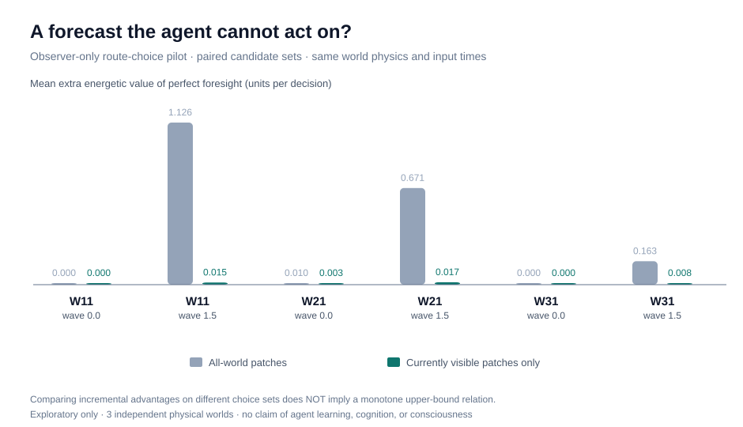
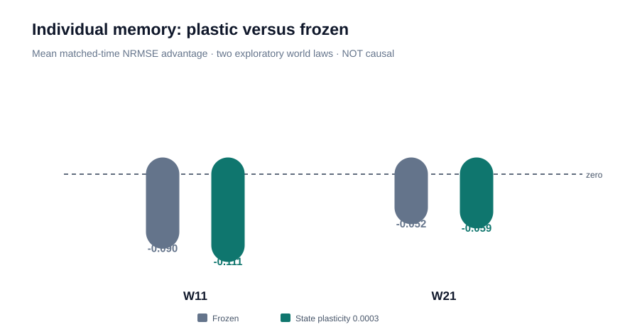

# CIVITAS ZERO

**From a decodable state to knowledge that changes survival.**

CIVITAS ZERO is an open, experiment-first artificial-life research programme built on [Latent Worlds](../../README.md). The physical laws, reproduction, energy budget, and agent reward **do not contain** a prescribed language, civilisation, science, or curiosity objective.

### A strong-looking forecasting opportunity — but whose actions are available?

Three *exploratory* independent world laws (W11, W21, W31) were tested with the original observer-side ideal foresight comparator. A resource wave of strength 1.5 creates substantial energetic value for future-informed route selection; no agent receives that knowledge. See [pilot table](figures/FORESIGHT_RESULTS.md). The original oracle chooses globally among all resource patches, whereas simulated agents perceive only local patches. This is a *privileged upper-context comparison*, not proof that the agent can realize its value.

### A new experimental falsification: perception versus theoretical information value

In three PILOT worlds with resource waves, the global-choice extra value (1.126, 0.671, 0.163) drops to 0.015, 0.017, 0.008 when **both** forecasters can choose only among resources presently visible under the world's exact observation radius and obstacle occlusion. This comparison of incremental values is DESCRIPTIVE: shrinking the set of actions is not generally monotone in value-of-information gain, and agents may explore to reveal new patches. See [full accessibility audit](figures/ACCESSIBILITY_PILOT.md).

A separate source-level test establishes that the generic recurrent controller explicitly encodes only the **nearest** resource, despite the observation API returning multiple visible patches. This is a specific architecture bottleneck worth testing causally; it is not a general impossibility result.

### Could synchronized world time masquerade as individual knowledge?

The new two-world PILOT exchanges complete hidden states among agents at *the same world timestamp* and trains time-ordered observer decoders with identical raw cues. In both worlds, most individual hidden states fail to beat a different agent's matched-time state. [Detailed methods, all frozen controls, negative findings and preregistration candidate](synchrony/RESULTS_AND_NEXT.md). The negative result is not yet a causal claim. A discovered lookahead bug in a secondary negative control was corrected *before publishing*; raw trajectories and [the correction log](data/synchrony_pilot/CORRECTION_LOG.md) are retained.

## At a glance

| Milestone | Question | Evidence status |
|:--|:--|:--|
| v3–v4 | Does semantically empty information transmission support cumulative adaptation? | Rare mechanisms; strong adaptive replication not established |
| v5.3 | Does recurrent-state plasticity create excess predictive carriers? | **Exploratory**; selected rate 0.0003 from 5 candidates |
| v5.4 | Does that rate survive 16 *new* population seeds? | **Failed preregistered joint gate** |
| Next | Are decoded hidden features causally used for decisions, and does the effect transfer across independent physical worlds? | **Unrun hypothesis** |

The latest archived result is a **negative** replication, not a discovery of cognition.

### Reproduce every figure and number

The 16 seed-level observations, frozen manifest and original summary live in [data/v54](data/v54).
No simulation is required to regenerate the result:

~~~bash
python experiments/civitas_zero/analysis/analyze_v54.py
python experiments/civitas_zero/analysis/plot_foresight_pilot.py
python -m pytest -q tests/test_civitas_analysis.py tests/test_civitas_v54.py
~~~

Outputs:

- [Scientifically audited table](figures/V54_RESULTS.md)
- [Full numerical reanalysis](figures/v54_audit.json)
- [Vector figure suitable for manuscripts](figures/v54_effects.svg)
- [Observer-side opportunity pilot data](data/foresight_pilot/results.json)
- [Local access pilot](data/local_foresight_pilot/results.json)
- [Matched-time exchange trace and statistical controls](synchrony/PROTOCOL.md)

To rerun the **expensive original experiment**, use the existing [v5.4 prospective runner](benchmark_v54_prospective.py), Python >= 3.11 and the project's environment. The 16 population histories share world W11; they are not 16 independent world laws. Replaying all three treatments for all seeds is time-consuming. Existing archived seed records are never silently overwritten.

## Proposed paper

**Working title:** *The Decodability–Selection Gap: Prospective Tests of Predictive State in Survival-Driven Artificial Life.*

- [Manuscript skeleton](paper/MANUSCRIPT.md)
- [Publication-grade acceptance criteria and next experiment](paper/PROTOCOL.md)
- [Novelty audit and competing work](paper/PRIOR_ART.md)

A successful **mechanism** paper must demonstrate predictive information that is causally needed for useful action, with matched controls and independent world generalization. Alternatively, a strong **negative benchmark** paper must establish practically meaningful failure, with sufficient precision to distinguish absence of an effect from an underpowered experiment. Nonsignificant p-values alone support neither route.

## Scientific guardrails

1. Do **not** add a "discovery" bonus, explicit truth labels, a science agent or a technology tree.
2. Observer-only decoders never feed hidden law parameters back to the agents.
3. Distinguish *decodable information*, *selection by survival*, *causal behavioral use*, and *socially inherited knowledge*.
4. Keep pre-registered results even when they fail.
5. Never infer phenomenal consciousness from a simulated society or an introspection metric.

## Repository design

- Python source and tests remain small, readable, and deterministic.
- Data provenance is immutable: world seeds, population seeds and the fixed treatment appear in each artifact.
- Plots use a pure-standard-library SVG generator, so the paper figure does not require notebook state or a proprietary dashboard.
- Work is isolated on a research branch; the publication baseline remains untouched.

Source: [Latent Worlds](https://github.com/StoicPawn/latent-worlds). See [project-wide methods](paper/PROTOCOL.md).
