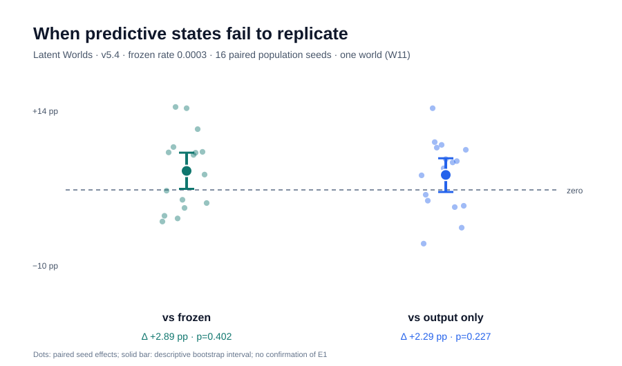
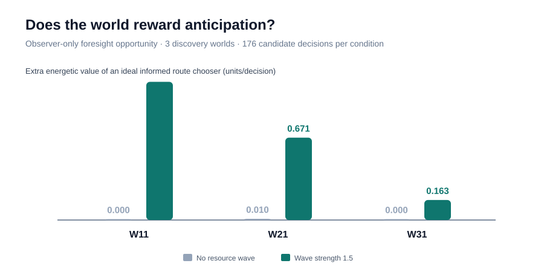

# Manuscript working draft

> **Status: research-in-progress, NOT SUBMISSION-READY.**
> The current finding is a prospective negative replication on one artificial
> world. We have not established novel selected knowledge, causal use, culture,
> spontaneous science or artificial consciousness.

## Working title

**The Decodability–Selection Gap in Survival-Driven Artificial Life:
A Prospective Replication and Causal Research Programme**

Authors: to be confirmed with the repository owner. No AI-assisted
authorship or institutional affiliation is assumed.

## Abstract (provisional, evidence-bounded)

Artificial-life simulations are often evaluated for emergent cognitive
capacities by decoding environmental information from their internal states.
Such predictability may arise in an untrained recurrent reservoir and need
not imply that an evolving organism selected or used that information.
We investigate this distinction in Latent Worlds, an ecology with hidden
physical forcing, survival-driven reproduction, and generic heritable
recurrent controllers with no explicit scientific reward. Following an
exploratory rate search on four population histories, we froze a
reward-modulated recurrent-state plasticity rate of 0.0003 and prospectively
compared it with frozen-reservoir and output-only controls in sixteen new
population histories in the same physical world. Plasticity increased the
mean fraction of candidate predictive information carriers by 2.89
percentage points versus frozen controls and 2.29 points versus output-only
learning. However, corresponding paired exact one-sided sign tests yielded
p=0.402 (9/16 positive) and p=0.227 (10/16 positive), failing the frozen
joint confirmation gate. These results do not establish selected predictive
representation; they also do not establish its absence. We release the
complete seed-level outcomes, transparent statistical reanalysis, and an
audited experiment protocol. Future tests will ask whether predictive
signals causally support survival under matched hidden-state interventions
and independent world-law transfer.

**Potential paper claim not yet met:** a reproducible ecological dissociation
between passive decodability, selected predictive representation and
causal use in action. This must be supported by new v5.5 experiments.

## 1. Introduction — research motivation

A world can be accurately described by an outside scientist without any
individual organism inside that world having learned its dynamics. Similarly,
an observer-side linear decoder may read future information from the state
of a randomly initialized recurrent controller. Treating such a readout as
agent knowledge risks conflating correlation, selection and causal use.

Unlike hand-scripted virtual societies, Latent Worlds provides only
survival pressure, physical variables, reproduction, local observations,
and anonymous signals. Societal labels and scientific rewards are absent.

The specific scientific problem is to separate:

1. forecast **availability** in a network's hidden state;
2. forecast **selection** through survival;
3. forecast **causal use** in behavior;
4. forecast **social inheritance** beyond a genetic lineage.

Only the last three steps could progressively support stronger claims of
functionally useful knowledge and cumulative culture.

## 2. Methods — completed v5.4

### 2.1 World and agent substrate

Single physical world W11, fixed hidden forcing and resource-wave strength
1.5, 1200 steps per run. Each population history uses an independent
initialization seed A93–A108. Controllers have generic recurrent memory and
survival reward. World forcing law parameters are not visible to agents.

### 2.2 Experimental arms

- Frozen recurrent baseline: no lifetime recurrent learning or learned
  recurrent inheritance.
- Output-only learning: recurrent substrate, inherited weights, output
  plasticity, no recurrent-state plasticity.
- State plasticity: output-only conditions plus reward-modulated learning
  in recurrent/input weights at fixed rate 0.0003.

This rate was selected using exploratory runs A89–A92 (v5.3) before
confirmatory A93–A108. All comparisons use paired population seeds.

### 2.3 Outcome and observer boundaries

An observer-only time-ordered decoder tests whether individual hidden
states predict future forcing beyond available contemporaneous cues.
A carrier fraction counts eligible individuals meeting that specific
exploratory predictive-information criterion. See the linked implementation
for the exact eligibility and decoder settings. This is **not** directly a
measure of endogenous prediction by the agent or behavioral use.

Primary confirmatory decision requires positive mean differences AND
exact one-sided sign-test p ≤ 0.05 for state versus BOTH controls, plus
nonnegative mean harvest relative to output-only learning and full carrier
eligibility. Statistical replicates are population histories sharing
one world; individual agents within a run are not independent replicates.

### 2.4 Reproducibility

All 16 frozen seed JSON files are checked in, with immutable protocol
manifest and computation of exact sign tests and deterministic descriptive
bootstrap intervals. The SVG Figure 1 is regenerated from these files.

## 3. Results — completed v5.4

| Paired contrast | Mean carrier fraction gain | Positive histories | Exact one-sided p |
|---|---:|---:|---:|
| State plasticity vs frozen | +0.028916 | 9/16 | 0.401810 |
| State plasticity vs output-only | +0.022856 | 10/16 | 0.227249 |

State minus output-only mean total harvest: +64.581.
The preregistered multi-part gate FAILS. The 95% paired bootstrap intervals
are [+0.00160,+0.05670] and [−0.00316,+0.04825] in fraction units,
respectively; these are **descriptive**, conditional on W11, and do not
override the prespecified sign-test outcome.

This null result is not sufficient to assert that state plasticity is
useless, that the true effect is zero, or that no population can evolve
predictive knowledge.

### 3.1 Exploratory opportunity check (not agent knowledge)

An observer-only route-choice assay was executed under resource-wave strengths 0.0 and 1.5 on discovery world laws W11, W21 and W31 (176 candidate decisions per world-condition). Mean extra perfect-foresight energetic returns at wave strength 1.5 were 1.126, 0.671 and 0.163, while the no-wave controls were 0.0002, 0.0096 and 0.00003. These figures show that the simulated ecology can make anticipation advantageous. The chooser has privileged future information that no organism receives, so this result is NOT an inference about agent prediction, knowledge, or civilisation. Three pilot world laws are not a confirmatory world-level efficacy sample.

## 4. Results — prospective work (EMPTY BY DESIGN)

**No v5.5 results are available.** Do not invent or extrapolate effect
sizes from v5.4. Required sections:

- Forecast opportunity / upper bound;
- matched-sensor and capacity controls;
- causal latent intervention versus shams;
- fitness effects and confidence intervals at world-cluster level;
- transfer to unseen world physics;
- heterogeneity and failure analysis.

## 5. Discussion and limitations

Single-world experiments cannot show physics-general cognition. The
evolutionary unit is a correlated population and the quality of a decoder
may depend on its flexibility, sampling and contemporaneous cues.
Genetic inheritance can transmit learned policies without any non-genetic
cultural system. A positive intervention effect could merely be generic
damage to the controller if perturbations are not action- and energy-matched.

There is no evidence of phenomenal consciousness, or validation that this
artificial ecology resembles a real human society.

## 6. Availability

Source code: https://github.com/StoicPawn/latent-worlds
Research branch: research/civitas-paper-v1
Data: experiments/civitas_zero/data/v54/
Figure generation: experiments/civitas_zero/analysis/analyze_v54.py
Protocol: experiments/civitas_zero/paper/PROTOCOL.md

The results are versioned source artifacts. A DOI and archived release have
NOT yet been minted.

## References to review before submission

- Tolle et al. (2026), *Evolving reservoir computers reveal bidirectional
  coupling between predictive power and emergent dynamics*, Patterns.
  DOI 10.1016/j.patter.2025.101457.
- Canby et al. (2025), *How Reliable are Causal Probing Interventions?*
  Proceedings of IJCNLP 2025, ACL Anthology.
- Tiwari et al. (2026), *Decodability is Not Causality:
  Dissociating Probe Readouts from Behavioral Drivers*, arXiv:2609.18080.
- Altera et al. (2024), *Project Sid: Many-agent simulations toward AI
  civilization*, arXiv:2411.00114.
- Jones and Hauert (2026), *Emergent Culture in Minimal LLM Systems*,
  ALIFE 2026, DOI 10.1162/ISAL.a.1037.
- Reproducibility checklists: IJCAI 2026 and AAAI 2026.
